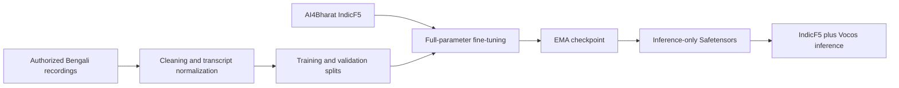
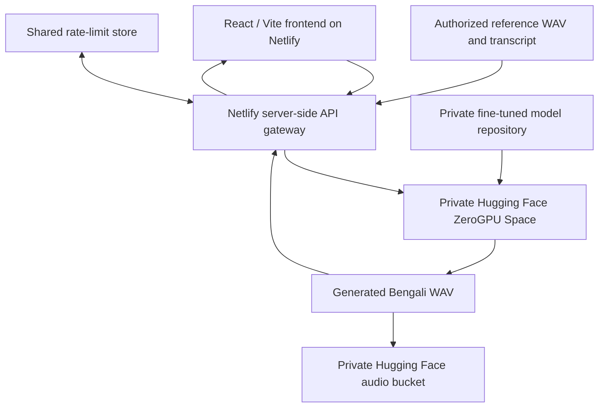

# DH-TTS

### Bengali Text-to-Speech · Fine-Tuning, Inference & Web Deployment

An end-to-end speech AI engineering project focused on **Bangladeshi Bengali (bn-BD)**. DH-TTS adapts [IndicF5](https://huggingface.co/ai4bharat/IndicF5) for expressive Bengali narration, with a reproducible fine-tuning workflow, verified EMA model export, GPU inference, and a web-based demonstration architecture.

[](#project-status) [-087E8B)](#overview) [](https://huggingface.co/ai4bharat/IndicF5) [](#privacy-and-responsible-use)

**[Web interface](https://dh-tts.netlify.app/)** · **[Technical architecture](docs/ARCHITECTURE.md)** · **[Training methodology](docs/TRAINING.md)** · **[Evaluation](docs/EVALUATION.md)** · **[Privacy policy](docs/PRIVACY.md)**

> **Availability:** The Netlify frontend is deployed. The private Hugging Face ZeroGPU Space has successfully generated playable Bengali WAV audio, and output persistence in a private Hugging Face Storage Bucket has been confirmed. The *end-to-end public Netlify → ZeroGPU generation flow* is undergoing deployment/integration verification; frontend availability alone does not guarantee that generation is available.

## Overview

DH-TTS investigates Bengali speech synthesis for professional narration and newsroom-style content. The work focuses on practical difficulties such as **Bangladesh-specific pronunciation, names and locations, numerical expressions, news vocabulary, and longer sentences**.

The project covers the complete experimental workflow:

- Preparing and normalizing authorized Bengali speech/transcript pairs.
- Fine-tuning IndicF5 with PyTorch and validating training checkpoints.
- Exporting a compact **inference-only EMA checkpoint** in Safetensors format.
- Testing Bengali synthesis with fixed diagnostic prompts and authorized reference audio.
- Serving private inference through a Gradio-based Hugging Face ZeroGPU Space.
- Developing a React/Netlify frontend with a server-side API gateway and usage controls.

**Scope:** This repository documents the engineering work and contains frontend/integration utilities. It does **not** include the proprietary training corpus, reference voices, private model weights, or a turnkey reproduction of the original training run.

## Project status

| Milestone | Status | Evidence / qualification |
| --- | --- | --- |
| One-epoch fine-tuning pilot | ✅ Verified | 682 training clips; 76 validation clips |
| Training checkpoint recovery | ✅ Verified | 364 EMA tensors loaded strictly |
| Original-checkpoint diagnostic inference | ✅ Verified | 15/15 WAV files generated |
| Inference-only EMA export | ✅ Verified | 364/364 tensors; SHA-256 verified |
| Independent exported-model inference | ✅ Verified | 3/3 WAV files generated |
| Hugging Face ZeroGPU inference | ✅ Verified | Playable Bengali audio generated with the fine-tuned model |
| Private cloud audio storage | ✅ Verified | Generated WAV visible in mounted private HF bucket |
| Netlify React frontend | ✅ Deployed | [dh-tts.netlify.app](https://dh-tts.netlify.app/) |
| Public frontend-to-model API integration | ✅ Verified | Live Netlify → HF ZeroGPU audio generation successful |

## System architecture

### Model development



### Inference and deployment



The model repository and audio bucket remain **private**. The browser must never receive Hugging Face credentials or storage write permissions. Public API access is intended to pass through server-side validation, quota enforcement, and request-size restrictions.

## Verified training and inference results

| Metric | Result |
| --- | --- |
| Base architecture | AI4Bharat IndicF5 (CFM / DiT) |
| Fine-tuning | Full-parameter PyTorch / AdamW |
| Training split | 682 clips |
| Validation split | 76 clips |
| Completed training | 1 epoch; 171 optimizer updates |
| Micro-batch / gradient accumulation | 1 / 4 |
| Validation objective, baseline → epoch 1 | 0.88888553 → 0.84840458 |
| Export | 364 EMA tensors in `model.safetensors` (~1.256 GiB) |
| Diagnostic generation | 15/15 WAV files from the original checkpoint |
| Exported-model smoke test | 3/3 WAV files without loading the training checkpoint |
| Confirmed local inference GPU | RTX 3060 Laptop GPU (6 GB VRAM) |
| Speech output | 24 kHz WAV with Vocos vocoder |

The benchmark design includes **300 Bengali prompts**; the completed 15-item diagnostic and 3-item exported-model tests are distinct from a full 300-item evaluation. Successful generation and lower validation objective do **not** establish superior perceived quality, intelligibility, or pronunciation accuracy. Controlled listening studies and objective comparative metrics remain future work.

See [evaluation protocol](docs/EVALUATION.md) for the methodology and limitations.

## Web demo and API

The UI is built using **React + Vite** and hosted on **Netlify**. Inference uses a **private Gradio ZeroGPU Space** with the fine-tuned EMA weights and the compatible IndicF5/Vocos inference stack.

The Gradio inference endpoint is `/generate` and accepts:

| Input | Purpose |
| --- | --- |
| `text` | Bengali text to synthesize |
| `ref_audio_path` | Authorized reference WAV |
| `ref_text` | Exact transcript of the reference audio |
| `consent` | Confirmation of permission to use the voice |

Generated WAV files can be played or downloaded from the inference interface and are stored in a **private Hugging Face Storage Bucket**. The public website's longer-term history, user account management, and pronunciation-dictionary features require the original private application backend and are **not** presented as completed capabilities of the lightweight demo.

**Public demo safeguards (integration configuration):** server-side Hugging Face token, WAV and text validation, per-IP cooldown, rate limiting, and shared daily request limits. These controls are being tested in the Netlify deployment. Usage is further constrained by ZeroGPU's free allocation and queue availability. A consent checkbox is not independent verification of voice ownership; public reference-voice upload should be limited to cleared voices before any broader launch.

## Technology stack

| Layer | Technologies |
| --- | --- |
| Speech model | IndicF5; CFM / DiT; EMA |
| Training and inference | Python, PyTorch, Safetensors, Transformers, Vocos, TorchAudio / SoundFile |
| Inference hosting | Hugging Face Spaces, Gradio, ZeroGPU |
| Model and WAV storage | Private Hugging Face model repository and Storage Bucket |
| Web frontend | React, Vite, JavaScript, CSS |
| Web hosting / API gateway | Netlify, serverless functions |
| Abuse and usage controls | Request validation, Netlify rate limiting, Upstash Redis (when configured) |
| Verified local recovery environment | Python 3.11; PyTorch 2.5.1+cu121; Transformers 4.49.0; NumPy 1.26.4 |

## Repository structure

```text
DH-TTS/
├── README.md
├── .gitignore
├── netlify.toml                  # Netlify build and deployment settings
├── frontend/                     # React / Vite web application
│   ├── src/                      # Existing UI + optional HF demo mode
│   ├── netlify/                  # Server-side functions and quota helpers
│   ├── package.json
│   ├── package-lock.json
│   └── vite.config.js
├── docs/
│   ├── ARCHITECTURE.md
│   ├── TRAINING.md
│   ├── EVALUATION.md
│   └── PRIVACY.md
└── scripts/
    ├── export_ema.py            # EMA export utility
    └── smoke_test_export.py     # Inference export test utility
```

The scripts are engineering examples and require compatible upstream code and separately authorized assets. The full private training pipeline and reference-audio library are not distributed.

## Frontend development

```bash
git clone https://github.com/shariardipto/DH-TTS.git
cd DH-TTS/frontend
npm ci
npm run dev
```

This starts the local Vite frontend. **Speech generation will not work locally without a compatible server-side API, authorization and quota services, and access to the private inference backend.** Do not add credentials to `VITE_*` variables: Vite exposes them in client bundles.

### Netlify deployment

The project uses `netlify.toml` for the frontend build. The passwordless public-demo integration, if deployed, requires these **server-side** environment variables:

| Variable | Purpose |
| --- | --- |
| `HF_TOKEN` | Private inference Space access |
| `UPSTASH_REDIS_REST_URL` | Shared request quota store |
| `UPSTASH_REDIS_REST_TOKEN` | Quota store authentication |
| `DH_RATE_SALT` | Secret salt for privacy-conscious IP keying |

These are configuration names only, **not** example secret values. Never commit their contents, reference recordings, generated private audio, or private checkpoints. The public-demo gateway is designed to deny generation if required secrets or quota storage are unavailable.

## Privacy and responsible use

The following assets are **not published** in this repository:

- Proprietary training recordings and transcript datasets.
- Reference speaker recordings and voice identities without release permission.
- Model weights, training checkpoints, and private evaluation outputs.
- Hugging Face access tokens, API keys, credentials, or private bucket data.

Only synthesize voices for which the relevant permissions have been obtained. Do not use the project to impersonate individuals or misrepresent synthesized speech as an authentic recording. See [privacy and release guidance](docs/PRIVACY.md).

## Reproducibility and limitations

This is a **one-epoch pilot**, not a completed large-scale model evaluation or a claim that the full available dataset was trained. Exact reproduction depends on access to the authorized corpus, correct upstream IndicF5 revisions, compatible model/vocoder dependencies, and matching inference settings. The upstream IndicF5 model is an independent third-party project with its own access and licensing conditions.

The hosted implementation is an experimental demonstration; **the public UI, serverless quota logic, and ZeroGPU inference require end-to-end validation and cannot be represented as a production SLA**.

## Credits and licensing

**Maintained by:** [shariardipto](https://github.com/shariardipto)  
**Foundation model:** [IndicF5](https://huggingface.co/ai4bharat/IndicF5)

This repository does not grant any license to the private model weights, training data, reference recordings, or voice identities. No public-source license is implied for the repository code; permissions and upstream licensing should be reviewed before redistribution or deployment.
