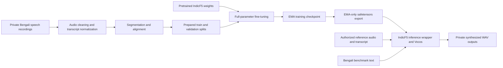

# DH-TTS — Bengali Speech AI Fine-Tuning & Inference

**An engineering case study in adapting AI4Bharat IndicF5 for Bangladeshi Bengali text-to-speech.**

> **Project status:** Fine-tuning and inference verified on a local workstation. The model weights, training audio, speaker references, and transcript dataset are private and **not distributed** in this repository.

## Project overview

DH-TTS explores Bangladeshi Bengali (bn-BD) speech synthesis for professional narration, including newsroom language, named entities, difficult pronunciations, numbers, and long-form sentences. The system uses the **AI4Bharat IndicF5** pretrained architecture with a supervised fine-tuning workflow, checkpoint validation, a fixed Bengali benchmark, and a portable inference-only export.

**Engineering scope:** corpus preparation, audio/text alignment and normalization, reproducible training configuration, EMA checkpoint management, benchmark design, model export, and inference validation.

## Verified engineering results

| Component | Observed result |
| --- | --- |
| Base model | AI4Bharat IndicF5 (CFM / DiT architecture) |
| Fine-tuning method | Full-parameter training with PyTorch and AdamW |
| Pilot training samples | 682 clips |
| Validation samples | 76 clips |
| Pilot training length | 1 epoch / 171 optimizer updates |
| Gradient accumulation | 4 (physical batch size 1) |
| Validation objective (baseline → epoch 1) | 0.88888553 → 0.84840458 |
| Training checkpoint | Recovered and verified; 364 EMA model tensors loaded |
| Original checkpoint inference | 15/15 benchmark WAV files generated |
| EMA-only export | 364/364 tensors verified; ~1.256 GiB safetensors |
| Exported model inference | 3/3 benchmark WAV files generated without the training checkpoint |
| Hardware used for recovered inference | NVIDIA GeForce RTX 3060 Laptop GPU, 6 GB VRAM |

**Important:** Lower validation loss is **not** proof of better human-perceived audio quality or pronunciation. No verified comparative MOS, WER, or phoneme-accuracy improvement is claimed here.

## Architecture



See [architecture](docs/ARCHITECTURE.md) and [training methodology](docs/TRAINING.md).

## Repository layout

```text
DH-TTS/
├── README.md
├── .gitignore
├── docs/
│   ├── ARCHITECTURE.md
│   ├── TRAINING.md
│   ├── EVALUATION.md
│   └── PRIVACY.md
└── scripts/
    ├── export_ema.py
    └── smoke_test_export.py
```

The two scripts are public-safe engineering utilities. **They require your own properly authorized inputs and compatible IndicF5 installation.** The private model or benchmark data is not included. These scripts do not provide the original recording dataset or a full turn-key training release.

## Technical stack

- **Model:** AI4Bharat IndicF5 (CFM and DiT)
- **ML:** PyTorch, EMA PyTorch, Safetensors
- **Speech:** 24 kHz synthesis with Vocos vocoder
- **Evaluation:** fixed 300-item bn-BD benchmark, 15-item diagnostic subset, and 3-item exported-model smoke test
- **Runtime verified:** Python 3.11, PyTorch 2.5.1+cu121, Transformers 4.49.0, NumPy 1.26.4

## Reproducibility and limitations

The pre-trained IndicF5 model and related dependencies are **separate third-party projects** and may require approval to access. Check the upstream model's licensing and acceptable-use conditions before deploying. The private voice and dataset are not available for unrestricted use.

The fine-tuning run described here is a **one-epoch pilot** over a prepared subset, not a claim that the complete corpus was used in that run. Recreating the exact results requires compatible base-model revisions, the authorized dataset, reference audio, and inference settings.

## Privacy and responsible use

The following are intentionally excluded from this public repository: model weights, full training checkpoints, reference-voice audio, source recordings, transcripts, generated speaker-clone audio without release consent, private evaluation CSVs, tokens, and credentials. See [privacy and release policy](docs/PRIVACY.md).

## Current status and next steps

- [x] Training checkpoint verified and restored
- [x] Fine-tuned EMA weights loaded in the original inference wrapper
- [x] Local Bengali benchmark generation succeeded
- [x] EMA-only model exported and tensor-verified
- [x] Exported model loaded and produced Bengali test WAVs
- [ ] Complete blinded, consent-compliant base-vs-fine-tuned human evaluation
- [ ] Publish permission-cleared, non-sensitive audio samples
- [ ] Build a controlled demonstration that does not disclose private voice assets

**Maintainer:** [shariardipto](https://github.com/shariardipto)

**Note on licensing:** This repository intentionally does not include a license grant for private recordings, voice identity, or model weights. Review code ownership before adding a public-source license.
