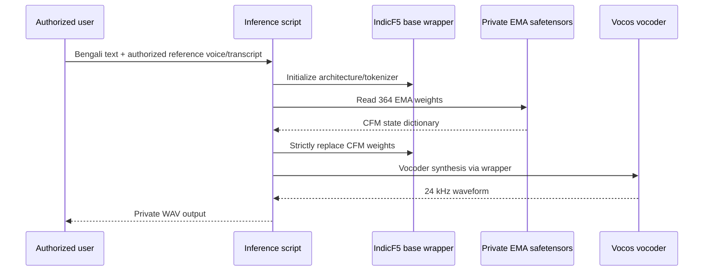

# System architecture

## Data and training

1. **Private speech capture and preparation:** reference recordings, cleaned audio, transcript normalization and audio/text alignment.
2. **Dataset packaging:** prepared bn-BD train and validation splits consumed by the IndicF5 dataset interface.
3. **Model initialization:** strict loading of the pretrained IndicF5 CFM/DiT model state (364 expected tensors).
4. **Fine-tuning:** AdamW on all model parameters, FP32 pilot training, gradient accumulation, norm clipping, warmup, EMA and periodic resumable checkpoints.
5. **Validation:** evaluation on a fixed validation split, with a baseline before fine-tuning and an end-of-epoch evaluation.

## Inference

The pretrained wrapper and vocoder remain required; an EMA-only `.safetensors` file is **not** a standalone downloadable speech service. The current public repo does not host arbitrary voice-cloning inference.

## Operational constraints

- Model and reference audio must be legally authorized before use.
- Keep credentials, reference identities, model files and sample audio outside public Git repositories.
- The initial demonstration used a 6 GB VRAM laptop GPU. This confirms one smoke-test environment, not a production-throughput benchmark.
